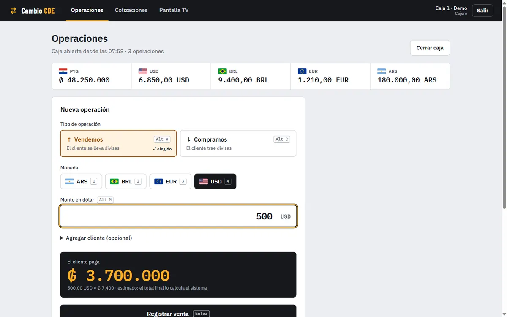
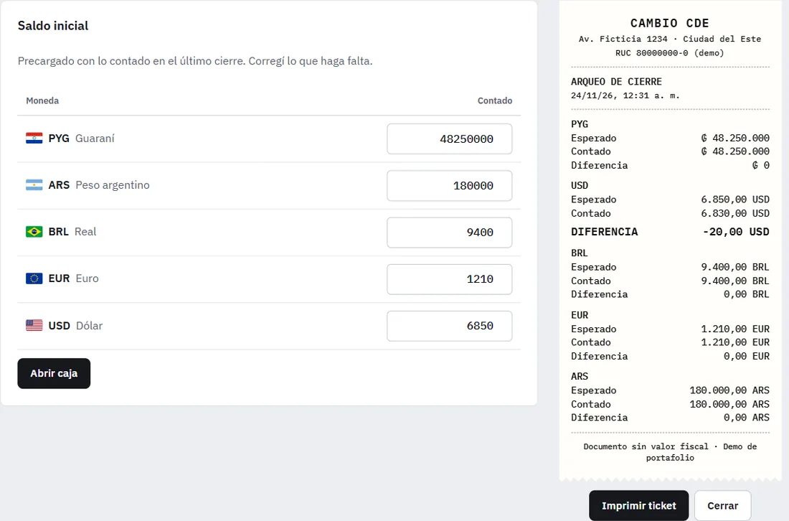

# Cambio CDE · Sistema para casa de cambios

[English below](#english)

Aplicación web para una casa de cambios de Ciudad del Este (Paraguay): cotizaciones del día, operaciones de compra y venta de divisas, caja con apertura y cierre por arqueo, anulaciones y una pantalla pública de cotizaciones para la TV del local.

**Demo:** https://cambio-cde-delta.vercel.app
Usuario demo (rol cajero): `demo@cambiocde.com` · contraseña `demo1234`
Pantalla TV pública: https://cambio-cde-delta.vercel.app/pantalla
La base de la demo es compartida: lo que cargues lo ven los demás visitantes. El usuario demo no puede anular operaciones, cargar cotizaciones ni cambiar su contraseña.
Presentación del proyecto: https://cambio-cde-delta.vercel.app/acerca


| Panel del cajero | Cierre de caja con ticket de arqueo |
| --- | --- |
|  |  |

## Funcionalidades

- **Login con roles** (`admin` y `cajero`) usando Supabase Auth.
- **Cotizaciones**: el admin carga compra y venta por moneda (USD, BRL, ARS, EUR); se guarda el historial y se usa siempre la vigente. El peso argentino se muestra y se carga **por cada 100 ARS** (₲ 440 en vez de ₲ 4,40), como en las pizarras de la calle; la base sigue guardando guaraníes por unidad.
- **Operaciones**: compra o venta de divisa con cliente opcional. El total en guaraníes lo calcula la base de datos con la cotización vigente, no el navegador.
- **Caja**: se abre contando el efectivo de cada moneda (precargado con lo contado en el último cierre) y se cierra con arqueo: saldo esperado, contado y diferencia, con comprobante imprimible.
- **Anulación**: solo el admin; revierte automáticamente los movimientos de caja y no se puede deshacer.
- **Pantalla TV** (`/pantalla`): pizarra 16:9 inspirada en las de las casas de cambio del centro de Ciudad del Este. Fichas split-flap que giran solo cuando cambia una cotización, banderas en SVG, reloj en vivo, modo pantalla completa y cursor que se oculta solo. **Se actualiza al instante con Supabase Realtime**, y si la conexión se corta vuelve a consultar cada 60 segundos hasta reconectar. Los títulos y las fichas comparten una sola grilla (subgrid) y el tamaño de las fichas sale del espacio real de la pantalla (container queries), así llenan una TV 16:9 con 2 o con 6 monedas.
- **Panel del cajero**: atajos de teclado (`Alt+V` venta, `Alt+C` compra, `Alt+1…4` moneda, `Alt+M` monto), total en guaraníes destacado, compra y venta diferenciadas con texto e ícono (no solo color), avisos al registrar, estados de carga y error, y tablas que se apilan en el celular.
- **Comprobantes con formato de ticket térmico de 80 mm**, listos para imprimir.
- **Presentación pública** (`/acerca`): qué es el sistema, capturas y decisiones técnicas. La raíz sin sesión lleva ahí; el login tiene un botón para entrar con la cuenta demo.

## Tecnologías

React 19 · TypeScript · Vite · React Router · Supabase (PostgreSQL, Auth, Row Level Security) · Vercel

## Diseño

La idea central es la pizarra luminosa de cotizaciones que tienen en la vereda las casas de cambio de Ciudad del Este: ámbar LED sobre negro y fichas split-flap. Esa identidad aparece en la pantalla TV, el login y la presentación. El panel del cajero es deliberadamente sobrio, de herramienta de trabajo: IBM Plex Sans con cifras tabulares (IBM Plex Mono para montos) y Barlow Condensed para la marca y la pizarra.

## Decisiones técnicas

- **La lógica de dinero vive en PostgreSQL.** Triggers toman la cotización vigente, calculan el monto en guaraníes y registran los movimientos de caja; un cliente modificado no puede inventar montos.
- **Row Level Security** en todas las tablas: el cajero opera, solo el admin carga cotizaciones y anula, y la pantalla TV lee cotizaciones sin login.
- **Apertura y cierre solo por funciones** (`abrir_caja`, `cerrar_caja`): no se puede cerrar una caja sin registrar el conteo.
- **Tiempo real con respaldo**: la pantalla se suscribe a los `INSERT` de `cotizaciones`. Hasta recibir el primer evento (prueba de que la tabla está publicada) o mientras el canal esté caído, sigue sondeando cada 60 s; con Realtime confirmado, solo hace una recarga de seguridad cada 5 minutos. Realtime respeta la política RLS de lectura pública que ya existía.
- **Saldos por sesión de caja** con una vista (`saldos_caja`) que suma los movimientos; las anulaciones generan movimientos inversos en lugar de borrar datos.

## Correrlo en tu máquina

Requisitos: Node.js 20+ y un proyecto gratuito en [Supabase](https://supabase.com).

1. En Supabase › SQL Editor ejecutá, en orden, `supabase/schema.sql`, `supabase/02_saldos_caja.sql` y `supabase/04_realtime.sql` (habilita el tiempo real de la pizarra). `03_proteger_demo.sql` es opcional: bloquea cambios al usuario demo.
2. En Authentication › Users creá tu usuario y hacelo admin:
   ```sql
   update public.perfiles set rol = 'admin' where id = (select id from auth.users where email = 'TU_EMAIL');
   ```
3. Copiá `.env.example` como `.env.local` y completá la URL y la anon key (Project Settings › API).
4. Instalá y arrancá:
   ```bash
   npm install
   npm run dev
   ```
5. Pruebas (formato de cotizaciones): `npm test`.

## Estructura

```
src/
  components/   Layout, Arqueo, Ticket, Pizarra (fichas split-flap), Bandera y Logo
  context/      Sesión, perfil del usuario y avisos (toast)
  lib/          Cliente de Supabase, hooks y formato de montos
  pages/        Login, Nueva operación, Cotizaciones, Pantalla TV y Acerca
supabase/       Esquema, triggers, políticas RLS y funciones de caja
```

## Autor

William Zarza · Estudiante de Ingeniería en Informática (Universidad Privada del Este)
[GitHub](https://github.com/williamzarza2003) · [LinkedIn](https://www.linkedin.com/in/william-zarza-293792451/)

---

## English

**Cambio CDE** is a web app for a currency exchange house in Ciudad del Este, Paraguay: daily rates, buy/sell operations, a cash drawer opened and closed with a cash count, voids, and a public rate board for the shop's TV.

- **Live demo:** https://cambio-cde-delta.vercel.app (demo user, cashier role: `demo@cambiocde.com` / `demo1234`) · TV board: [/pantalla](https://cambio-cde-delta.vercel.app/pantalla) · project page: [/acerca](https://cambio-cde-delta.vercel.app/acerca)
- **Stack:** React 19, TypeScript, Vite, React Router, Supabase (PostgreSQL, Auth, Row Level Security, Realtime), Vercel, Vitest.
- **Money logic lives in PostgreSQL:** triggers take the current rate, compute the amount in guaraníes and write the cash movements, so a tampered client cannot invent amounts. RLS on every table: cashiers operate, only admins load rates and void operations, and the TV board reads rates anonymously (read-only).
- **TV board:** split-flap tiles that flip only when a rate changes, updated instantly through Supabase Realtime with a 60-second polling fallback while the channel is down. Headers and tiles share one CSS subgrid and the tile size comes from container queries, so the board fills a 16:9 TV with any number of currencies.
- **Local conventions:** Argentine pesos are quoted per 100 ARS, as on the street boards in Ciudad del Este, while the database keeps guaraníes per unit.
- **Design:** inspired by the LED rate boards on the sidewalks of downtown Ciudad del Este (amber on black, split-flap tiles). The cashier panel is deliberately plain and keyboard-driven (`Alt+V`, `Alt+C`, `Alt+1…4`, `Alt+M`, `Enter`), with 80 mm thermal-ticket receipts.

**Run it:** create a free Supabase project, run `supabase/schema.sql`, `02_saldos_caja.sql` and `04_realtime.sql` in the SQL Editor, copy `.env.example` to `.env.local` with your URL and anon key, then `npm install && npm run dev`. Tests: `npm test`.

Author: William Zarza, Computer Engineering student · [GitHub](https://github.com/williamzarza2003) · [LinkedIn](https://www.linkedin.com/in/william-zarza-293792451/)
